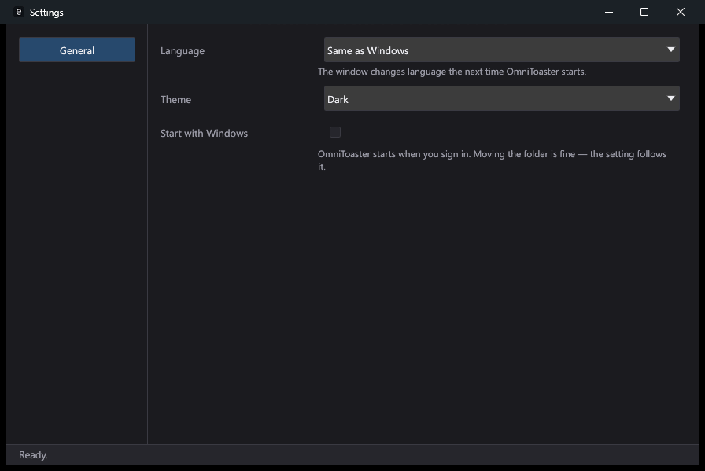
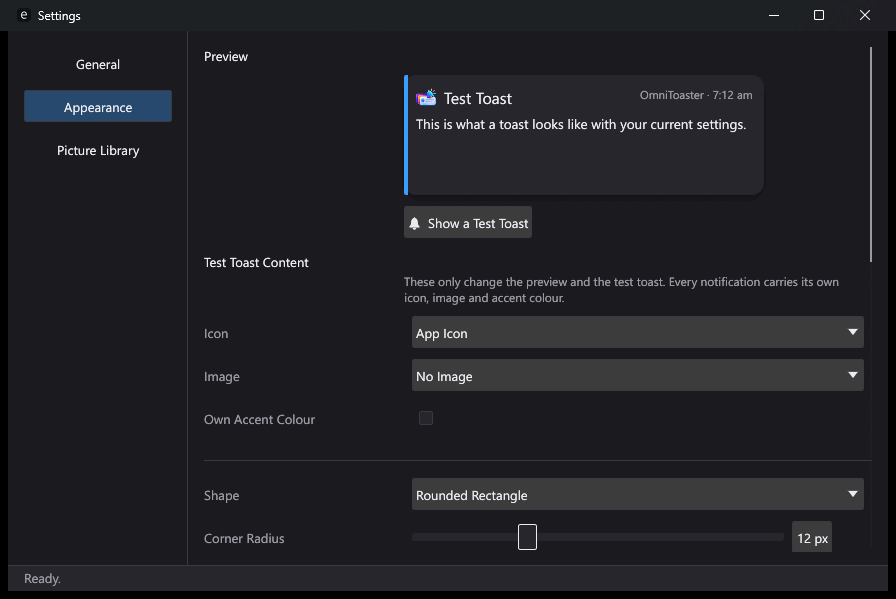
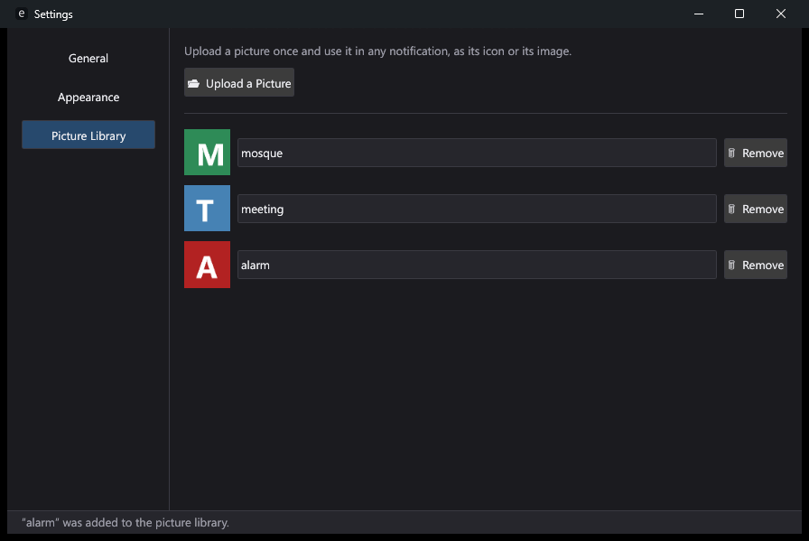

<div align="center">


# OmniToaster

</div>

OmniToaster is a portable Windows desktop application that delivers
customizable, Windows-style toast notifications for reminders, prayer times
(Azan), weather changes and time announcements. It runs in the system tray,
starts with Windows, recovers from crashes, and keeps every byte of its data in
an `OmniToasterData/` folder next to the executable.

**Status:** Phase 1 (Shell), in progress. The app starts in English or Malay,
keeps its data in a portable folder, refuses to run twice, lives in the
**system tray**, and opens a **settings window** with the General pane:
language, theme and Start with Windows. The language switches **while it
runs** — window, title bar and tray menu, in a few milliseconds, no restart.
Closing the window hides it; Quit is in the tray menu, which also pauses all
notifications for half an hour, an hour or until you resume them. There is
still no toast — that is Phase 2.
`--data-dir`, `--self-test`, `--version`, `--help`, `--lang` and `--worker`
all work.

> On Windows 11 a new tray icon starts in the **hidden-icons overflow**,
> behind the chevron at the left of the notification area. Drag it onto the
> taskbar to keep it in sight.

See [PROPOSAL.md](PROPOSAL.md) §13 for the phase plan and
[docs/CHECKLIST.md](docs/CHECKLIST.md) for progress.

---

## Notifications

Every notification is a *category* with its own template — title, description,
image, accent colour, sound and style overrides — in both languages:

| Type | What it does |
|---|---|
| **Azan prayer** | The five daily prayers, plus optional Syuruk and Jumu'ah, with per-prayer audio and an optional pre-prayer reminder |
| **Weather change** | Fires on a condition change (clear, cloudy, rain, storm, snow, fog) or a temperature threshold |
| **Event** | A one-off or recurring calendar-style reminder |
| **Task** | A to-do with an offset-before trigger |
| **Anniversary** | Yearly recurrence |
| **Fatigue** | Eye breaks, posture and hydration, each on its own schedule |
| **Timer** | A countdown from now |
| **Alarm** | A persistent toast that stays until dismissed |
| **Payment** and **Appointment** | Offset-before reminders for dated obligations |
| **Hourly time announcement** | The time spoken aloud in the active language — hourly, every 30 or 15 minutes, start or end of day, or at custom times |

Scheduling supports exact times, offsets before (15 minutes to a week, or
custom), and recurrence (once, daily, weekly, monthly, yearly). Snooze is 5
minutes to a day, with a configurable maximum per reminder. Reminders missed
while the PC was off or asleep are listed at next start.

## Bilingual

Every user-visible string — labels, toasts, validation messages, prayer names,
spoken announcements — comes from a Fluent key in both English (`en-US`) and
Bahasa Melayu (`ms-MY`). The language follows the Windows display language by
default and can be switched at runtime from Settings; the tray menu and every
open window re-render within a second, with no restart and no data migration.
Malay spelling follows Dewan Bahasa dan Pustaka. Prayer names are shown in both
sets, for example "Subuh (Fajr)", so users of either can find the prayer.

## Appearance

Three themes — **Dark (the default)**, Light, and System, which follows the
Windows light/dark setting. A global accent colour, with an optional per-category
override.

Toasts are painted by the app, not handed to the Action Center, so almost
everything about them is a setting:

- **Shape:** rectangle, rounded rectangle or pill, with a corner radius of 0–40 px
- **Size:** width 280–600 px (default 360), height auto or fixed
- **Colour:** solid or gradient background, border width and colour, shadow off/soft/strong
- **Transparency:** 70–100 % opacity; the whole toast fades, text included
- **Glass:** none, Blur, Acrylic or Mica-like
- **Animations:** eight-plus in presets — slide from right, slide from bottom,
  Genie from bottom, pop out, drawer, appear, dissolve, glow, alpha-to-solid —
  each with a mirrored out preset plus "shrink to tray", a 150–1000 ms duration
  and linear, ease-out or spring easing. A reduced-motion option follows the
  Windows "Show animations" setting and falls back to fade
- **Duration:** 3–60 seconds (default 8), or persistent for urgent types, with
  hover pausing the timer
- **Header:** icon, title, app name and timestamp, each toggleable
- **Body:** text with bold and italic, plus an image (PNG, JPG or WebP, up to 5 MB)
- **Picture Library:** upload a picture once — a mosque, a meeting, an alarm
  clock — name it, and use it in any notification as its icon or its image.
  Removing a picture still in use asks first
- **Position and stacking:** nine presets or a point of your own, on the primary
  monitor or one you choose, 1–5 visible at once
- **Accent bar:** on the side of the toast that faces the screen's edge, with
  that side square

## Prayer times

Inside Malaysia the default source is **JAKIM e-Solat**, by zone code (about 60
zones), so times match the mosques, schools and government offices users follow.
The app detects the location, proposes the nearest zone and asks the user to
confirm it. Times are fetched for the current and next month, cached, and
refreshed weekly.

Outside Malaysia — or offline, or when e-Solat is unavailable — times are
**calculated** with the `adhan` crate. Method presets are Muslim World League,
ISNA, Umm al-Qura and "Malaysia (JAKIM angles, approximate)" at Fajr 20.0° and
Isha 18.0°. Asar follows Shafi'i by default. Calculated times inside Malaysia
are labelled approximate. The source in use, and the time of the last fetch, are
always on screen.

## Portable mode

The executable never writes outside its own folder — no registry beyond the
`Run` autostart value, no `%APPDATA%`, no `%TEMP%`:

```
OmniToaster/
├── OmniToaster.exe                 # Supervisor (default) and worker (--worker)
├── README.md
└── OmniToasterData/
    ├── config/settings.toml        # Language, theme, toast style, location, prayer, startup
    ├── data/omnitoaster.db         # SQLite: reminders, categories, caches, history
    ├── locales/                    # Optional user overrides of the embedded .ftl files
    ├── assets/                     # User images, Azan audio, chimes, icons
    ├── logs/                       # Daily rotating log, plus crash/
    └── cache/                      # Weather and geolocation responses, TTL-based
```

At startup the app checks that `OmniToasterData/` is writable; if it is not (the
exe sits in `Program Files`, say) it shows a bilingual error and exits without
touching existing data. User media is copied in under content-hashed names, and
paths are stored relative, so the folder can be moved or carried on a stick.

## Requirements

- Windows 10 version 1809 or later, or Windows 11, 64-bit
- A stable Rust toolchain with the MSVC target, to build from source
- No installer, no administrator rights, no account

## Build and run

```bash
cargo build --release -p omnitoaster
```

Produces `target/release/OmniToaster.exe`.

```bash
cargo run -p omnitoaster -- --data-dir ./tmp-data
```

Runs against a throwaway data folder. **Always pass `--data-dir` with a scratch
folder while developing**, so the real `OmniToasterData/` beside the exe is
never touched.

```bash
cargo run -p omnitoaster -- --self-test
```

The smoke check CI runs.

A running `OmniToaster.exe` keeps its own file locked, so a release build fails
with "Access is denied" while an instance is open — `Stop-Process -Name
OmniToaster -Force` first.

## Restrictions and non-goals

- **Windows only** for this release. Platform code is isolated in one crate so
  other systems can be added later.
- **Not the Action Center.** OmniToaster paints its own windows; it does not
  replace or hook into the native Windows notification system.
- **No cloud, no accounts, no telemetry.** Nothing leaves the machine except
  requests to Open-Meteo, the IP geolocation service and JAKIM e-Solat — all
  HTTPS, and each can be turned off. Crash reports stay local and are never
  uploaded.
- **Glass effects need Windows 10 1809+** and fall back to a solid background.
- **Expensive animations degrade.** Each effect has a frame-time budget and
  falls back to fade below 30 fps.
- **No Jawi script** and no languages beyond English and Malay in this release.
- **Text-to-speech uses installed Windows voices.** With no voice for the active
  language the app plays the chime and shows a setup hint; it downloads nothing.

## The icon


`assets/icon/omnitoaster-512.png` is the master. Every other size, and
`omnitoaster.ico` for the executable, is generated from it by
`scripts/make-icons.ps1` — never edited by hand, so the sizes cannot drift
apart. The `.ico` carries 16 through 256 and is embedded into
`OmniToaster.exe` at build time along with the version metadata Explorer
shows in Properties ▸ Details.

<br clear="left">

Sizes at or below 32 px are sharpened after downscaling. Without it the card
stack and the bell merge into a coloured blob at 16 px, which is the size the
tray and the title bar use. Even sharpened, 16 px is the weakest size: the
artwork has three stacked cards, a bell and its rays, which is a lot of detail
for 256 pixels.

## Screenshots

Settings ▸ General, the first screen the app has:



The same pane in Bahasa Melayu is
[settings-general-ms.png](docs/screenshots/settings-general-ms.png).

Settings ▸ Appearance, where the preview is drawn by the same code as a real toast:



In Bahasa Melayu: [settings-appearance-ms.png](docs/screenshots/settings-appearance-ms.png).

Settings ▸ Picture Library, where pictures are uploaded once and named:



In Bahasa Melayu, asking before removing a picture the test toast uses:
[settings-pictures-ms.png](docs/screenshots/settings-pictures-ms.png). The rest
are **not captured yet** — the screens do not exist. The places are reserved
and the capture procedure is written down in
[docs/screenshots/README.md](docs/screenshots/README.md); each image below is
taken as its phase lands:

| Image | Shows | Lands in |
|---|---|---|
| `docs/screenshots/toast-dark.png` | A toast in the Dark theme | Phase 2 |
| `docs/screenshots/toast-glass.png` | The Acrylic glass effect | Phase 3 |
| `docs/screenshots/tray-menu.png` | The tray icon and its menu | Phase 1 |
| `docs/screenshots/settings-prayer.png` | Settings → Prayer, zone confirmation and source label | Phase 5 |
| `docs/screenshots/animation-in.gif` | The in and out animations | Phase 3 |
| `docs/screenshots/flow-reminder.gif` | Creating a reminder and seeing it fire | Phase 4 |

Each screenshot is taken in both English and Malay before Phase 9 ships.

## Licence

MIT. See [LICENSE](LICENSE).

## Attribution

Official prayer times come from **JAKIM e-Solat** (Jabatan Kemajuan Islam
Malaysia, `e-solat.gov.my`). OmniToaster is not affiliated with or endorsed by
JAKIM. Where times are shown from that source the app labels them "Source:
JAKIM e-Solat" with the time of the last fetch; calculated times are labelled as
calculated. Whether the JAKIM dataset may be bundled with a release is settled
by the terms check in Phase 9 — until then the data is fetched or downloaded by
the user.

Weather data comes from [Open-Meteo](https://open-meteo.com/) under its own
terms. Prayer calculation uses the [`adhan`](https://crates.io/crates/adhan)
crate.
