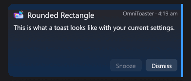
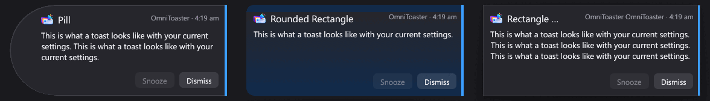
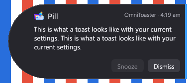
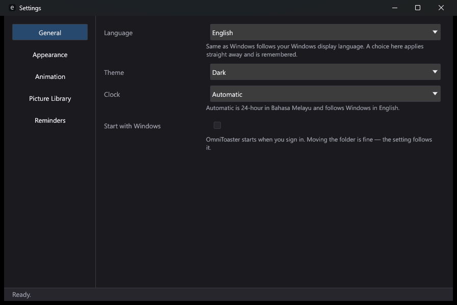
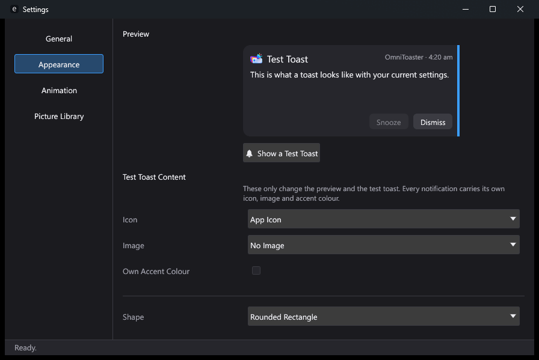
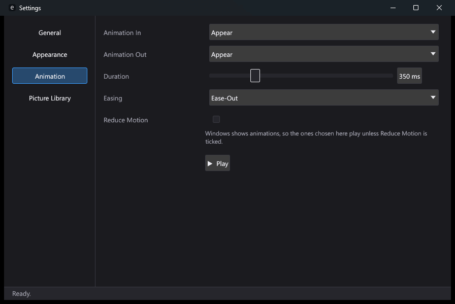
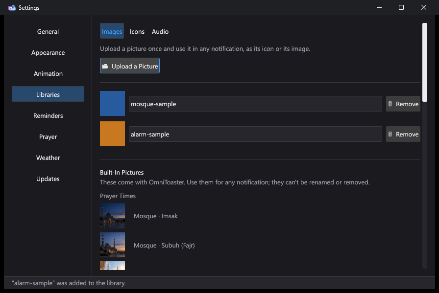
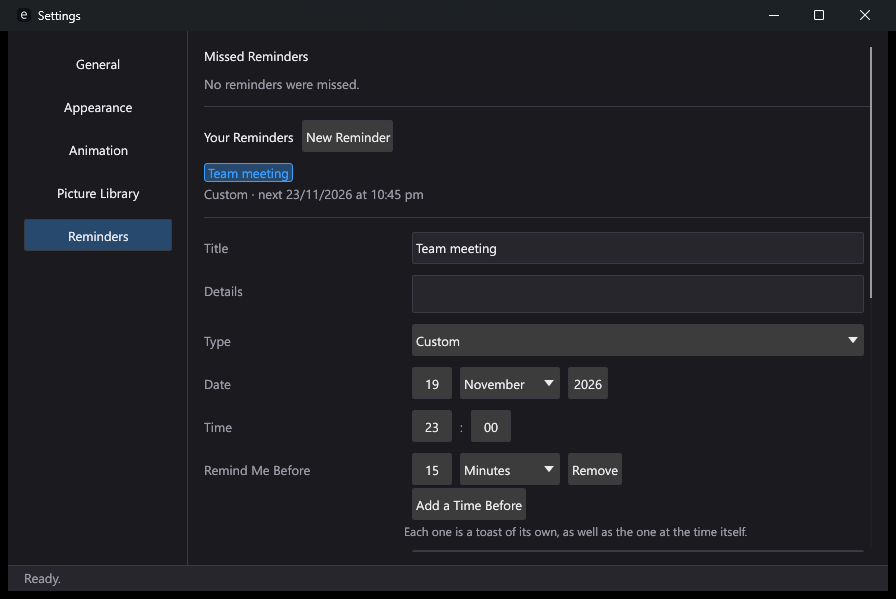

<div align="center">


# OmniToaster

</div>

[English](README.md) · **Bahasa Melayu**

OmniToaster ialah aplikasi desktop Windows mudah alih yang memaparkan
pemberitahuan toast gaya Windows yang boleh disesuaikan untuk peringatan,
waktu solat (azan), perubahan cuaca dan pengumuman masa. Ia berjalan di dulang
sistem, bermula bersama Windows, pulih sendiri selepas ranap, dan menyimpan
setiap bait datanya dalam folder `OmniToasterData/` di sebelah fail bolehlakunya.

**Status:** Fasa 0–2 telah selesai: aplikasi bermula dalam bahasa Inggeris atau
bahasa Melayu, menyimpan datanya dalam folder mudah alih, enggan berjalan dua
kali, tinggal di **dulang sistem** dan melukis **toast**nya sendiri — tiga
bentuk, sembilan kedudukan pada skrin atau titik pilihan anda sendiri, pada
monitor yang anda pilih, dengan pustaka gambar, serta pratonton langsung dalam
Tetapan ▸ Penampilan. Bahasa dan tema bertukar **semasa aplikasi berjalan**.
Dwiklik ikon dulang untuk membuka Tetapan; menutup tetingkap itu membiarkan
aplikasi terus berjalan di sebalik ikon, dan Keluar terdapat dalam menu dulang,
yang juga boleh menjeda semua pemberitahuan selama setengah jam, sejam atau
sehingga anda menyambungnya semula. **Peringatan** dibuat dalam Tetapan ▸
Peringatan dan dipaparkan sebagai toast tepat pada masanya, dengan tunda,
susulan peringatan yang terlepas dan sejarah; azan dan cuaca ialah fasa
seterusnya.
`--data-dir`, `--self-test`, `--version`, `--help`, `--lang` dan `--worker`
semuanya berfungsi.

> Pada Windows 11, ikon dulang yang baharu bermula dalam **limpahan ikon
> tersembunyi**, di sebalik anak panah di sebelah kiri kawasan pemberitahuan.
> Seret ikon itu ke bar tugas supaya sentiasa kelihatan.

Lihat [PROPOSAL.md](PROPOSAL.md) §13 untuk rancangan fasa dan
[docs/CHECKLIST.md](docs/CHECKLIST.md) untuk kemajuan. Dokumen pembangun
ditulis dalam bahasa Inggeris.

---

## Pemberitahuan

Setiap pemberitahuan ialah satu *kategori* dengan templatnya sendiri — tajuk,
keterangan, imej, warna aksen, bunyi dan gaya tersendiri — dalam kedua-dua
bahasa:

| Jenis | Fungsinya |
|---|---|
| **Azan** | Lima waktu solat harian, serta Syuruk dan Jumaat secara pilihan, dengan audio bagi setiap waktu dan peringatan sebelum waktu secara pilihan |
| **Perubahan cuaca** | Dipaparkan apabila keadaan berubah (cerah, berawan, hujan, ribut, salji, kabus) atau suhu melepasi had |
| **Acara** | Peringatan sekali atau berulang, seperti dalam kalendar |
| **Tugasan** | Tugasan dengan pencetus sebelum masanya |
| **Ulang tahun** | Berulang setiap tahun |
| **Keletihan** | Rehat mata, postur badan dan minum air, masing-masing dengan jadualnya sendiri |
| **Pemasa** | Kiraan detik dari sekarang |
| **Penggera** | Toast yang terus dipaparkan sehingga anda bertindak, hingga sepuluh minit |
| **Bayaran** dan **Temu janji** | Peringatan sebelum masa untuk urusan bertarikh |
| **Pengumuman masa setiap jam** | Masa disebut dengan suara dalam bahasa aktif — setiap jam, setiap 30 atau 15 minit, pada awal atau akhir hari, atau pada masa tersuai |

Peringatan dibuat dan disunting dalam Tetapan ▸ Peringatan: tajuk dan butiran
dalam kata-kata anda sendiri, salah satu jenis di atas, tarikh dan masa,
sebarang bilangan masa "ingatkan saya sebelum", dan ulangan. Penyunting
menyatakan apa yang salah di bawah medan berkenaan, dan memadam peringatan atau
mengosongkan sejarahnya akan bertanya dahulu. Setiap peringatan menunjukkan
sejarah terbarunya: dipaparkan, ditunda, ditutup, dibuka, terlepas. Buka pada
toast peringatan membawa anda terus kepadanya di situ.

Penjadualan menyokong masa tepat, tempoh sebelum (15 minit hingga seminggu,
atau tersuai) dan ulangan (sekali, harian, mingguan, bulanan, tahunan). Tunda
menangguhkan peringatan selama 5 minit, 15 minit, sejam, sehari atau tempoh
pilihan anda sendiri, yang dipilih dalam Tetapan ▸ Peringatan, sehingga had
bagi setiap paparan (10 secara lalai); selepas itu toast hanya menawarkan
Tutup dan menyatakannya. Peringatan yang terlepas semasa PC dimatikan atau tidur
tidak dipaparkan serentak apabila aplikasi bermula semula: satu toast
memberitahu ada yang terlepas, dan Tetapan ▸ Peringatan menyenaraikannya
dengan Tunda dan Tutup. Yang lebih lama daripada tempoh susulan (24 jam secara
lalai) digugurkan dan direkodkan.

## Dwibahasa

Setiap rentetan yang dilihat pengguna — label, toast, mesej pengesahan, nama
waktu solat, pengumuman bersuara — datang daripada kunci Fluent dalam bahasa
Inggeris (`en-US`) dan bahasa Melayu (`ms-MY`). Secara lalai, bahasa mengikut
bahasa paparan Windows dan boleh ditukar semasa aplikasi berjalan daripada
Tetapan; menu dulang dan setiap tetingkap yang terbuka dilukis semula dalam
masa sesaat, tanpa perlu dimulakan semula dan tanpa pemindahan data. Ejaan
bahasa Melayu mengikut Dewan Bahasa dan Pustaka. Nama waktu solat dipaparkan
dalam kedua-dua bentuk, contohnya "Subuh (Fajr)", supaya pengguna kedua-duanya
dapat mencarinya.

## Penampilan

Tiga tema — **Gelap (lalai)**, Cerah dan Sistem, yang mengikut tetapan
cerah/gelap Windows. Satu warna aksen global, dengan pilihan untuk menggantinya
bagi setiap kategori.

Toast dilukis oleh aplikasi ini sendiri, bukan diserahkan kepada Pusat Tindakan
Windows, jadi hampir setiap aspeknya boleh ditetapkan:

- **Bentuk:** Segi Empat Tepat, Segi Empat Bucu Bulat atau Pil, dengan jejari
  bucu 0–40 px
- **Saiz:** lebar 280–600 px (lalai 360), tinggi automatik atau tetap
- **Warna:** latar belakang padu atau kecerunan, lebar dan warna sempadan, serta
  bayang untuk bentuk Segi Empat Tepat
- **Lut sinar:** kelegapan 70–100 %; seluruh toast pudar, termasuk teksnya
- **Kaca:** Tiada, Kabur, Akrilik atau Seperti Mika — desktop di belakang toast
  Segi Empat Tepat, dikaburkan oleh Windows, di bawah 45 %, 60 % atau 88 %
  warna toast. Untuk Segi Empat Tepat sahaja, kerana Windows mengaburkan
  melepasi bucu bulat; memerlukan Windows 10 1809 atau lebih baharu, dan dilukis
  padu apabila Windows menolak. Toast berkaca tidak mempunyai bayang
- **Animasi:** lebih daripada lapan pratetap — gelongsor dari kanan, gelongsor
  dari bawah, Genie dari bawah, timbul, laci, muncul, larut, cahaya, lut sinar
  ke padu — setiap satunya dengan pratetap keluar yang bercermin serta "kecut
  ke dulang", tempoh 150–1000 ms dan pelonggaran linear, perlahan di hujung
  atau pegas, dipilih dalam Tetapan ▸ Animasi, tempat Mainkan menunjukkan
  toast ujian dengannya. Kurangkan Gerakan — atau tetapan "Tunjukkan animasi"
  Windows yang dimatikan — memainkan setiap satunya sebagai pudar, dan animasi
  yang jatuh di bawah 30 fps berakhir sebagai pudar
- **Tempoh paparan:** 3–60 saat (lalai 8), atau kekal bagi jenis yang mendesak,
  dengan kiraan masa dijeda semasa penuding berada di atas toast
- **Pengepala:** ikon, tajuk, nama aplikasi dan cap masa, masing-masing boleh
  dihidupkan atau dimatikan
- **Isi:** teks dengan huruf tebal dan condong, serta imej (PNG, JPG atau WebP,
  hingga 5 MB)
- **Tindakan:** satu hingga tiga butang di bahagian bawah — Tunda, Tutup, Buka.
  Tutup menutup toast dengan animasi keluarnya, Buka membawa Tetapan ke
  hadapan, dan Tunda menangguhkan peringatan; pada toast yang tiada apa-apa
  untuk ditunda, seperti toast ujian, Tunda dikelabukan
- **Pustaka Gambar:** muat naik gambar sekali — masjid, mesyuarat, jam loceng —
  namakannya, dan gunakannya dalam mana-mana pemberitahuan sebagai ikon atau
  imejnya. Membuang gambar yang masih digunakan akan meminta pengesahan dahulu.
  Sembilan belas gambar disertakan bersama aplikasi — masjid bagi setiap waktu
  solat, sembilan jenis cuaca, jam loceng, mesyuarat dan sesi latihan — sedia
  untuk dipilih daripada senarai yang sama
- **Kedudukan dan susunan:** sembilan pratetap atau titik pilihan anda sendiri,
  pada monitor utama atau monitor yang anda pilih, 1–5 dipaparkan serentak
- **Bar aksen:** pada sisi toast yang menghadap tepi skrin, dengan sisi itu
  bersegi

## Waktu solat

Di dalam Malaysia, sumber lalai ialah **JAKIM e-Solat**, mengikut kod zon
(kira-kira 60 zon), supaya waktunya sepadan dengan masjid, sekolah dan pejabat
kerajaan yang diikuti pengguna. Aplikasi mengesan lokasi, mencadangkan zon
terdekat dan meminta pengguna mengesahkannya. Waktu solat diambil untuk bulan
semasa dan bulan berikutnya, disimpan dalam cache, dan dikemas kini setiap
minggu.

Di luar Malaysia — atau semasa luar talian, atau apabila e-Solat tidak dapat
dicapai — waktu solat **dikira** dengan crate `adhan`. Pratetap kaedah ialah
Muslim World League, ISNA, Umm al-Qura dan "Malaysia (sudut JAKIM, anggaran)"
dengan Subuh 20.0° dan Isyak 18.0°. Asar mengikut mazhab Syafie secara lalai.
Waktu yang dikira di dalam Malaysia dilabel sebagai anggaran. Sumber yang
digunakan, dan masa pengambilan terakhir, sentiasa dipaparkan pada skrin.

## Mod mudah alih

Fail bolehlaku tidak pernah menulis di luar foldernya sendiri — tiada
pendaftaran selain nilai mula automatik `Run`, tiada `%APPDATA%`, tiada
`%TEMP%`:

```
OmniToaster/
├── OmniToaster.exe                 # Penyelia (lalai) dan pekerja (--worker)
├── README.md
└── OmniToasterData/
    ├── config/settings.toml        # Bahasa, tema, gaya toast, lokasi, solat, permulaan
    ├── data/omnitoaster.db         # SQLite: peringatan, kategori, cache, sejarah
    ├── locales/                    # Gantian pengguna bagi fail .ftl terbenam (pilihan)
    ├── assets/                     # Imej pengguna, audio azan, bunyi loceng, ikon
    ├── logs/                       # Log harian berputar, serta crash/
    └── cache/                      # Respons cuaca dan geolokasi, mengikut TTL
```

Semasa bermula, aplikasi memeriksa sama ada `OmniToasterData/` boleh ditulis;
jika tidak (fail bolehlaku berada dalam `Program Files`, misalnya), ia
memaparkan ralat dwibahasa dan keluar tanpa menyentuh data sedia ada. Media
pengguna disalin masuk dengan nama berasaskan cincangan kandungan, dan laluan
disimpan secara relatif, jadi folder itu boleh dipindahkan atau dibawa dalam
pemacu kilat.

## Keperluan

- Windows 10 versi 1809 atau lebih baharu, atau Windows 11, 64-bit
- Rantai alat Rust stabil dengan sasaran MSVC, untuk membina daripada kod sumber
- Tiada pemasang, tiada hak pentadbir, tiada akaun

## Membina dan menjalankan

```bash
cargo build --release -p omnitoaster
```

Menghasilkan `target/release/OmniToaster.exe`.

```bash
cargo run -p omnitoaster -- --data-dir ./tmp-data
```

Berjalan dengan folder data sementara. **Sentiasa berikan `--data-dir` dengan
folder sementara semasa membangunkan**, supaya `OmniToasterData/` sebenar di
sebelah fail bolehlaku tidak pernah disentuh.

```bash
cargo run -p omnitoaster -- --self-test
```

Semakan asas yang dijalankan oleh CI.

`OmniToaster.exe` yang sedang berjalan mengunci failnya sendiri, jadi binaan
keluaran gagal dengan "Access is denied" semasa satu salinan masih terbuka —
jalankan `Stop-Process -Name OmniToaster -Force` dahulu.

## Sekatan dan perkara di luar skop

- **Windows sahaja** untuk keluaran ini. Kod platform diasingkan dalam satu
  crate supaya sistem lain boleh ditambah kemudian.
- **Bukan Pusat Tindakan.** OmniToaster melukis tetingkapnya sendiri; ia tidak
  menggantikan atau mencangkuk ke dalam sistem pemberitahuan asli Windows.
- **Tiada awan, tiada akaun, tiada telemetri.** Tiada apa-apa yang meninggalkan
  komputer kecuali permintaan kepada Open-Meteo, perkhidmatan geolokasi IP dan
  JAKIM e-Solat — semuanya melalui HTTPS, dan setiap satunya boleh dimatikan.
  Laporan ranap kekal di komputer dan tidak pernah dimuat naik.
- **Kesan kaca memerlukan Windows 10 1809 atau lebih baharu** dan beralih kepada
  latar belakang padu jika tidak tersedia.
- **Animasi yang berat akan direndahkan.** Setiap kesan mempunyai bajet masa
  bingkai dan beralih kepada pudar apabila di bawah 30 fps.
- **Tiada tulisan Jawi** dan tiada bahasa selain bahasa Inggeris dan bahasa
  Melayu dalam keluaran ini.
- **Teks ke pertuturan menggunakan suara Windows yang dipasang.** Jika tiada
  suara untuk bahasa aktif, aplikasi memainkan bunyi loceng dan memaparkan
  petunjuk persediaan; ia tidak memuat turun apa-apa.

## Ikon


`assets/icon/omnitoaster-512.png` ialah induknya. Setiap saiz lain, dan
`omnitoaster.ico` untuk fail bolehlaku, dijana daripadanya oleh
`scripts/make-icons.ps1` — tidak pernah disunting dengan tangan, supaya
saiz-saiz itu tidak berbeza antara satu sama lain. Fail `.ico` itu mengandungi
saiz 16 hingga 256 dan dibenamkan ke dalam `OmniToaster.exe` semasa binaan
bersama metadata versi yang dipaparkan Explorer dalam Properties ▸ Details.

<br clear="left">

Saiz 32 px dan ke bawah ditajamkan selepas dikecilkan. Tanpanya, timbunan kad
dan loceng bercantum menjadi satu tompok berwarna pada 16 px, iaitu saiz yang
digunakan oleh dulang dan bar tajuk. Walaupun ditajamkan, 16 px ialah saiz yang
paling lemah: lukisannya mempunyai tiga kad bertindih, sebuah loceng dan
sinarnya, iaitu butiran yang banyak untuk 256 piksel.

## Tangkapan skrin

Toast, sebagaimana dilukis oleh aplikasi — di sini pada kedudukan lalai Bawah
Kanan, jadi bar aksen berada pada sisi yang menghadap tepi skrin:



Tiga bentuk, masing-masing dengan sisi yang bertentangan dengan tepi skrin
bersegi:



Toast yang sama di atas tetingkap cerah ialah
[toast-light.png](docs/screenshots/toast-light.png): toast mengekalkan warnanya
sendiri walau apa pun tema tetingkap itu.

Toast Segi Empat Tepat dengan kaca Akrilik: desktop di belakangnya — di sini
tetingkap berjalur — dikaburkan oleh Windows di bawah 60 % warna toast itu:



Gelongsor dari Kanan, masuk dan keluar, dan Jin dari Bawah, yang mencurah keluar
dari tepi bawah skrin berjalur-jalur — kedua-duanya dirakam daripada binaan
keluaran:


Tetapan ▸ Umum, skrin pertama aplikasi ini:



Panel yang sama dalam bahasa Melayu ialah
[settings-general-ms.png](docs/screenshots/settings-general-ms.png).

Tetapan ▸ Penampilan, tempat pratonton dilukis oleh kod yang sama seperti toast
sebenar:



Dalam bahasa Melayu: [settings-appearance-ms.png](docs/screenshots/settings-appearance-ms.png).

Tetapan ▸ Animasi, tempat animasi masuk dan keluar, tempoh dan pelonggarannya
dipilih, tetapan animasi Windows sendiri dinyatakan di bawah Kurangkan Gerakan,
dan Mainkan memaparkan toast ujian dengannya:



Dalam bahasa Melayu: [settings-animation-ms.png](docs/screenshots/settings-animation-ms.png).

Tetapan ▸ Pustaka Gambar, tempat gambar dimuat naik sekali dan dinamakan,
dengan gambar yang disertakan bersama aplikasi disenaraikan di bawahnya:



Skrin yang sama dalam bahasa Melayu:
[settings-pictures-ms.png](docs/screenshots/settings-pictures-ms.png).

Tetapan ▸ Peringatan: peringatan yang terlepas, peringatan anda dengan yang
sedang disunting, sejarahnya, serta tempoh dan had Tunda dan tempoh susulan di
bawahnya:



Dalam bahasa Melayu: [settings-reminders-ms.png](docs/screenshots/settings-reminders-ms.png). Yang
selebihnya **belum ditangkap** — skrinnya belum wujud. Tempatnya telah dikhaskan
dan prosedur tangkapannya ditulis dalam
[docs/screenshots/README.md](docs/screenshots/README.md); setiap imej di bawah
diambil apabila fasanya siap:

| Imej | Menunjukkan | Dalam fasa |
|---|---|---|
| `docs/screenshots/tray-menu.png` | Ikon dulang dan menunya | Fasa 1 |
| `docs/screenshots/settings-prayer.png` | Tetapan → Solat, pengesahan zon dan label sumber | Fasa 5 |
| `docs/screenshots/flow-reminder.gif` | Mencipta peringatan dan melihatnya dipaparkan | Fasa 4 |

Setiap tangkapan skrin diambil dalam bahasa Inggeris dan bahasa Melayu sebelum
Fasa 9 dikeluarkan.

## Lesen

MIT. Lihat [LICENSE](LICENSE).

## Atribusi

Waktu solat rasmi datang daripada **JAKIM e-Solat** (Jabatan Kemajuan Islam
Malaysia, `e-solat.gov.my`). OmniToaster tidak bergabung dengan atau disokong
oleh JAKIM. Apabila waktu dipaparkan daripada sumber itu, aplikasi melabelnya
"Sumber: JAKIM e-Solat" berserta masa pengambilan terakhir; waktu yang dikira
dilabel sebagai dikira. Sama ada set data JAKIM boleh disertakan bersama
keluaran akan diputuskan oleh semakan terma dalam Fasa 9 — sehingga itu, data
diambil atau dimuat turun oleh pengguna.

Data cuaca datang daripada [Open-Meteo](https://open-meteo.com/) di bawah
termanya sendiri. Pengiraan waktu solat menggunakan crate
[`adhan`](https://crates.io/crates/adhan).
